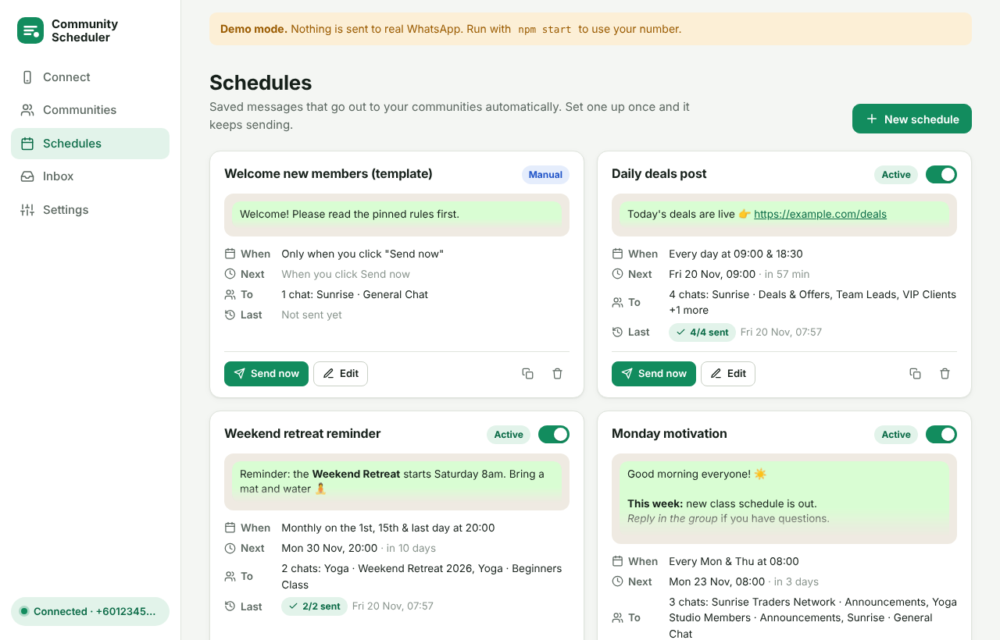
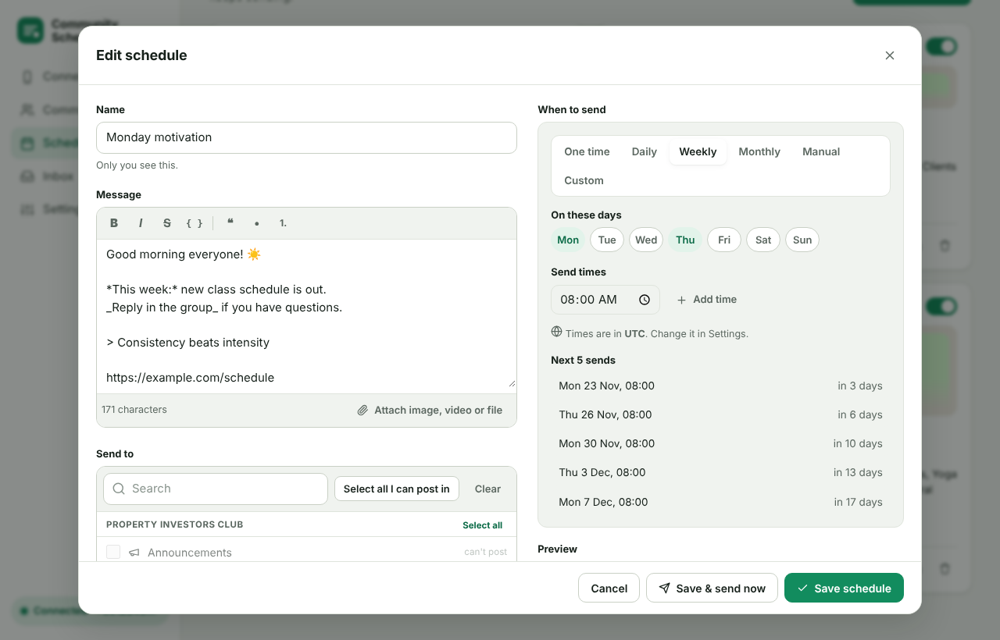
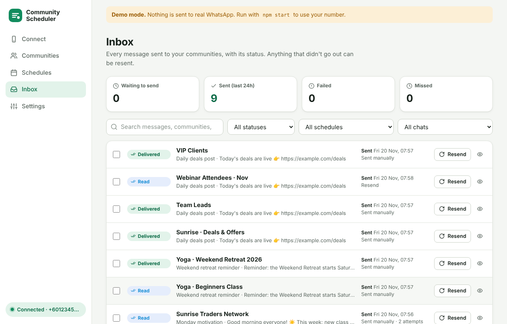

# Community Scheduler for WhatsApp

Set a message once, pick your WhatsApp communities, choose when it goes out, and it keeps sending by itself. Every send shows up in an inbox with its status, and anything that didn't go out can be resent with one click.



## What it does

| Tab | What you do there |
| --- | --- |
| **Connect** | Link your WhatsApp number by scanning a QR code or typing an 8-character pairing code on your phone. You only do this once. |
| **Communities** | See every community (its Announcements group and sub-groups) and every group your number is in, plus where you're allowed to post. Tick some and create a schedule for them. |
| **Schedules** | Write the message (text, and optionally an image, video or file), pick the communities, pick when: one time, daily, weekly, monthly, "only when I click Send now", or a custom cron. Pause, edit, duplicate or send now at any time. |
| **Inbox** | Every message to every community, with its status: *Queued, Sending, Sent, Delivered, Read, Failed, Missed, Cancelled*. Filter by status, schedule or community. Resend one, a selection, or all failed ones at once. |
| **Settings** | Timezone, the pause between messages, retries, and how late a missed message may still go out. |

<p>


</p>

### How it connects

The app links to your number as a **linked device**, the same way WhatsApp Web or WhatsApp Desktop do (it uses the open-source [Baileys](https://github.com/WhiskeySockets/Baileys) library). Your phone keeps working normally. The official WhatsApp Business API is built for one-to-one business messages and can't post into Communities you already run, which is why this app works like WhatsApp Web instead.

Things to know about WhatsApp Communities:

- You can't post into the community itself. Posts go to its **Announcements** group, which reaches every member, and only **community admins** can post there. Link a number that is an admin.
- Sub-groups and regular groups work as long as the number is allowed to send messages in them.
- The Communities tab marks anything you can't post in, and the app won't let you pick it.

## Quick start (your own computer)

You need **Node.js 20 or newer**: download the LTS version from [nodejs.org](https://nodejs.org).

In a terminal, go into the app folder (the one with `package.json`) and run:

```bash
npm install
npm start
```

Open **http://localhost:3000**, go to **Connect**, and link your number:

- **QR code:** on your phone, open WhatsApp → *Settings* (iPhone) or *⋮ menu* (Android) → *Linked devices* → *Link a device*, and scan the code on screen.
- **Phone number:** type your number with country code (digits only, e.g. `60123456789`). The app shows an 8-character code. On the phone: *Linked devices* → *Link a device* → *Link with phone number instead*, then type the code.

Then go to **Communities**, tick where you want to post, and click **Create schedule**.

### Try it first without WhatsApp

```bash
npm run demo
```

This starts the same dashboard with pretend communities, so you can click through everything. Nothing is sent to WhatsApp, and demo data is kept separate (in `data-demo/`). Roughly 1 in 8 pretend sends fail on purpose so you can see retries and the Resend button.

## Keep it running 24/7

Schedules only go out while the app is running. If it's on your laptop and the laptop sleeps, sends are missed. For "set it and forget it", run it on a machine that is always on. Missed messages show up as **Missed** in the Inbox, and you can resend them.

### Option A: Railway (easiest, nothing to manage)

[Railway](https://railway.com) runs the app straight from your GitHub repository, keeps it on 24/7, and gives it a permanent disk. The Hobby plan (about US$5 a month) covers this app.

1. Put this project in your own GitHub repository.
2. On Railway: **New Project → Deploy from GitHub repo**, pick the repository. Railway finds the `Dockerfile` and builds it.
3. Open the service → **Variables** and add:
   - `ADMIN_PASSWORD`: a strong password. The dashboard will be on the internet.
   - `TZ`: your timezone, e.g. `Asia/Kuala_Lumpur`.
   - `RAILWAY_RUN_UID` = `0`, so the app may write to the volume.
4. Add a **Volume**, attach it to the service, and set the mount path to **`/data`**. It keeps your WhatsApp login, schedules and history across deploys. Without it you'd have to link your phone again after every deploy.
5. **Settings → Networking → Generate Domain**. Open the `https://…up.railway.app` address, log in, and link your number on the **Connect** tab.

Keep it at **one replica**: two copies would fight over the same WhatsApp login.

### Option B: a small cloud server with Docker

Any small Linux server works (DigitalOcean, Hetzner, Vultr, Lightsail and similar cost about US$4–6 a month; 1 GB RAM is enough).

```bash
git clone <your repository>
cd <your repository>      # the folder with package.json and Dockerfile
cp .env.example .env
nano .env                 # set ADMIN_PASSWORD (required on a server) and TZ
docker compose up -d --build
```

Open `http://<server-ip>:3000`, log in with your password, and link your number.

- Your login and data live in a Docker volume, so they survive restarts and updates.
- To update: `git pull && docker compose up -d --build`.
- To see logs: `docker compose logs -f`.
- To reach it over HTTPS with your own domain, put it behind a reverse proxy such as [Caddy](https://caddyserver.com) (`reverse_proxy localhost:3000`). Until you do, avoid logging in over public Wi-Fi.

### Option C: a server or always-on PC without Docker

```bash
npm install
cp .env.example .env      # set ADMIN_PASSWORD and HOST=0.0.0.0 if other devices need access
npm install -g pm2
pm2 start npm --name community-scheduler -- start
pm2 save && pm2 startup   # start again automatically after a reboot
```

**Vercel, Netlify and similar "serverless" hosts don't work**, and neither do free tiers that sleep when idle. They only run code for a few seconds per web request and have no permanent disk, while this app has to stay connected to WhatsApp around the clock and keep its `data` folder.

## Settings that matter

| Setting | Default | Why |
| --- | --- | --- |
| Pause between messages | 10–25 s, random | Sends one at a time with a human-like gap. With 20 communities a run takes about 6–7 minutes. |
| Show "typing…" | On | Briefly shows typing before each message, like a person would. |
| Late-send window | 60 min | If the app or WhatsApp was offline at send time, it still sends when it's back if no more than this late. Otherwise the message is marked **Missed** so you can decide (a "Good morning" at 6 pm is usually worse than none). |
| Automatic retries | 2 | A failed send is retried 30 s and 60 s later before it's marked **Failed**. |
| Keep history | 90 days | Older inbox rows (and attachments nothing uses any more) are cleaned up. |

`.env` options: `ADMIN_PASSWORD`, `PORT` (3000), `HOST` (127.0.0.1), `TZ`, `DATA_DIR`, `LOG_LEVEL`. See [.env.example](.env.example).

## Message status, explained

| Status | Meaning |
| --- | --- |
| Queued | Waiting its turn, or waiting for WhatsApp to reconnect. |
| Sending | Going out right now. |
| Sent | WhatsApp accepted it. |
| Delivered / Read | At least one member's phone received / opened it. (Groups don't report every member.) |
| Failed | Couldn't be sent after the automatic retries. The error says why. Click **Resend**. |
| Missed | The app was off or disconnected at the scheduled time and it was too late to send. Click **Resend** if it's still useful. |
| Cancelled | You cancelled it before it went out, or deleted its schedule. |

If the app is ever stopped in the middle of a send, that one message is marked **Failed** with a note instead of being sent again automatically, so nobody gets a double post. Check the community and resend only if it's missing.

## Please read: risks and good practice

This app uses WhatsApp's linked-device protocol through an unofficial library. That is how many tools work, but it isn't approved by WhatsApp, and WhatsApp can restrict or ban numbers it believes are spamming. Posting your own announcements to communities you run, at a normal pace, is low risk but not zero. To stay safe:

- Only post where members expect your messages (your own communities and groups).
- Keep the default pacing. Don't blast dozens of groups every few minutes.
- Vary repeated messages now and then rather than sending the identical text forever.
- Open WhatsApp on the phone at least every 14 days, or the linked device is logged out.
- If you see **Logged out** on the Connect tab, the device was unlinked from the phone. Link it again; your schedules are kept.

**Your data:** everything is stored in the `data/` folder (`DATA_DIR`): `whatsapp-auth/` is your WhatsApp login (treat it like a password, never share or commit it), `db.json` holds schedules, settings and history, `uploads/` holds attachments. Back up the folder to keep your schedules. The app only talks to WhatsApp, plus GitHub (to check the current WhatsApp Web version) and any website you link to in a message (to build the link preview).

## Troubleshooting

- **"Only admins can send messages here"**: make the linked number an admin of that community or group, then click **Refresh** on the Communities tab.
- **QR code expired**: click **Show QR code** again. The code refreshes for a couple of minutes, then stops.
- **"Could not reach WhatsApp's servers"**: the computer or server has no internet, or a firewall blocks `web.whatsapp.com`.
- **"This login was opened somewhere else"**: two copies of the app are running with the same login. Stop one, then reconnect.
- **Port 3000 already in use**: set `PORT=3001` (or another number) in `.env`.
- **Schedule times are off by some hours**: check the timezone in **Settings**.

## For developers

```bash
npm test        # schedule math, send queue, API (uses the demo driver, no WhatsApp needed)
npm run demo    # dashboard with pretend data
```

```
src/
  server.js           starts everything
  app.js              HTTP API, login, live updates (Server-Sent Events)
  scheduler.js        finds due schedules every 15 s, works out the next run
  schedule.js         one-time / daily / weekly / monthly / cron rules, timezone aware
  sender.js           the outbox: one message at a time, pacing, retries, receipts, missed
  store.js            JSON file storage in data/db.json
  whatsapp/baileys.js real WhatsApp connection (QR or pairing code)
  whatsapp/mock.js    pretend WhatsApp for demo mode and tests
public/               the dashboard (plain HTML, CSS, JS; no build step)
```

`npm audit` reports an advisory in `link-preview-js`, which Baileys uses to build link previews for URLs in your own messages. Only URLs you write yourself are fetched, so the server-side request issue it describes doesn't apply here.
